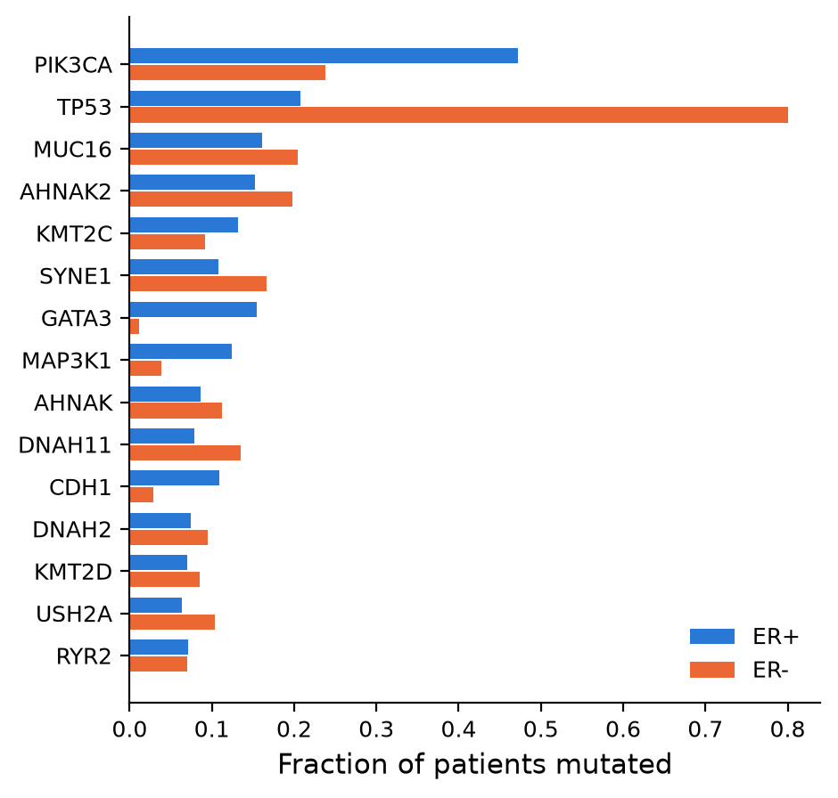
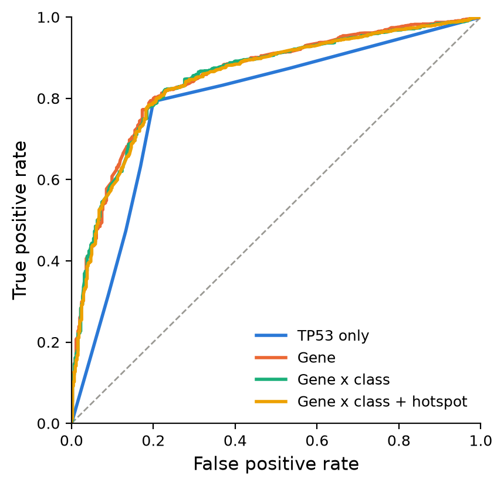
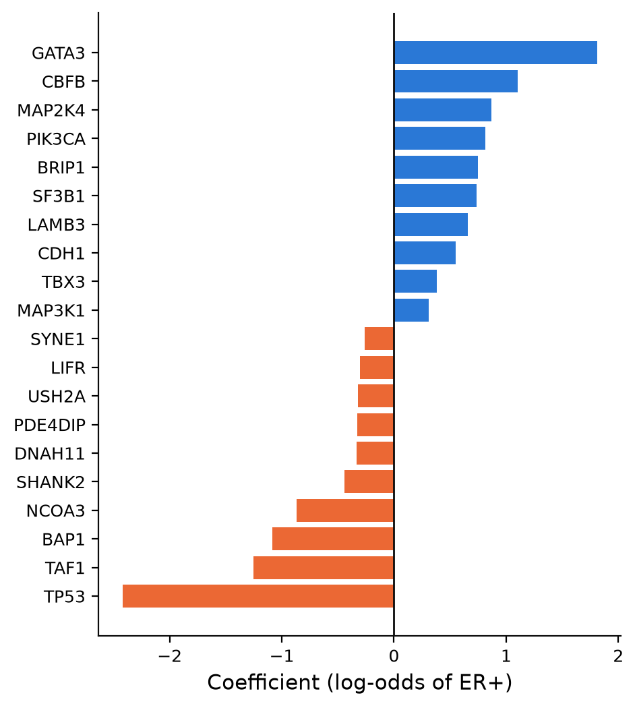
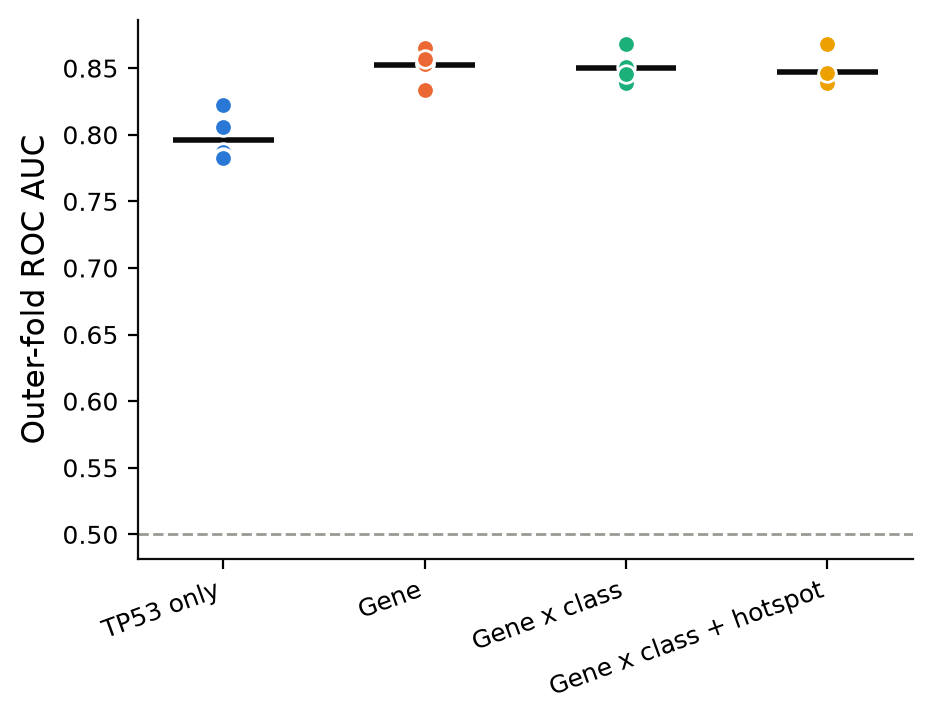
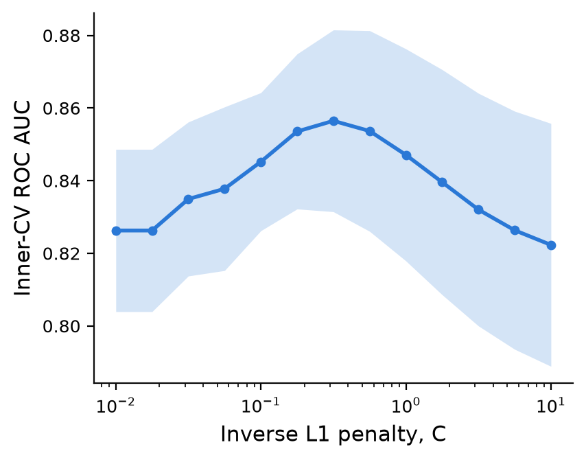
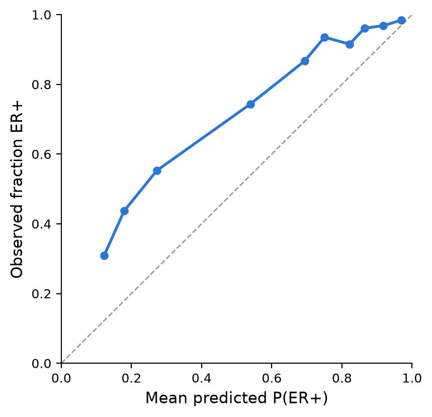

# Predicting breast cancer ER status from somatic mutations (METABRIC)

Can a tumor's somatic mutation profile tell us whether it is estrogen receptor
positive (ER+) or negative (ER-)? This project fits L1-penalized logistic
regression models to 173 sequenced genes in the METABRIC cohort and evaluates
them with nested cross-validation. 

## Introduction

ER status is one of the most important clinical features of a breast tumor:
it decides whether a patient receives endocrine therapy and is tied to
distinct molecular subtypes. ER status is measured from protein
(immunohistochemistry), but the subtypes it marks are thought to arise from
different genetic paths. **Hypothesis:** the somatic mutations in a tumor carry
enough information to predict its ER status.

The data are the
[METABRIC breast cancer gene expression profiles](https://www.kaggle.com/datasets/raghadalharbi/breast-cancer-gene-expression-profiles-metabric)
from Kaggle: 1,904 patients (1,459 ER+, 445 ER-) with clinical data, mRNA
z-scores and targeted sequencing of 173 genes. Only the 173 `*_mut` columns are
used as predictors. Each holds `0` (no mutation) or one or more protein-change
codes such as `H1047R`, `R306*` or `X120_splice`.

## Results

**A handful of genes are mutated at very different rates by ER status.**
TP53 is mutated in 80% of ER- tumors but only 21% of ER+ tumors. PIK3CA (47%
vs 24%), GATA3 (15% vs 1%), MAP3K1 (12% vs 4%) and CDH1 (11% vs 3%) all lean
ER+.



**Mutations predict ER status well, and most of the signal is TP53.** A model
using TP53 alone reaches a cross-validated ROC AUC of 0.80. Adding all genes
raises it to 0.85. Splitting genes by mutation consequence (missense,
truncating, splice, ...) or adding recurrent hotspot alleles does not help
further.

| Feature set | Features | ROC AUC (mean ± sd, 5 outer folds) | Balanced accuracy |
|---|---:|---:|---:|
| TP53 only | 1 | 0.796 ± 0.017 | 0.796 |
| Gene (mutated yes/no) | 150 | **0.852 ± 0.012** | 0.796 |
| Gene x class | 180 | 0.850 ± 0.011 | 0.794 |
| Gene x class + hotspot | 203 | 0.847 ± 0.012 | 0.795 |



**The selected genes match known ER+ / ER- biology.** In the best model (gene
yes/no, refit on all patients) the largest coefficients pushing toward ER+ are
GATA3, CBFB, MAP2K4, PIK3CA and CDH1, which are classic luminal (ER+) drivers.
TP53, TAF1, BAP1 and NCOA3 push toward ER-. The L1 penalty keeps only a subset
of the 150 genes. The figure shows the 10 largest coefficients of each sign.



**Conclusion.** The hypothesis is supported: mutation status alone separates
ER+ from ER- tumors with an AUC of about 0.85. Most of that comes from TP53,
with a smaller, consistent gain from GATA3, PIK3CA, CBFB, MAP3K1, CDH1 and
others. Mutations are not a substitute for an ER assay. About 20% of ER+
tumors carry TP53 mutations and many tumors carry none of the informative
mutations.

### Model diagnostics

**Out-of-fold AUC is stable across folds.** Each dot is one outer test fold
and the bar is the mean. The spread between folds (sd about 0.01) is smaller
than the gap between TP53-only and the multi-gene models (about 0.05), but
larger than the differences among the three multi-gene encodings. Those three
should be treated as equivalent.



**The penalty is well tuned.** Inner-CV AUC (mean ± 1 sd over folds) peaks in
the middle of the C grid (C ≈ 0.3), not at an edge, so the search range is
adequate. Too much penalty drops informative genes and too little overfits
rare mutations.



**Probabilities are ranked well but not calibrated.** Out-of-fold predicted
probabilities sit below the diagonal on the observed scale. That is expected
from `class_weight="balanced"`, which re-weights the training data to a 50/50
class mix while the cohort is 77% ER+. The model is good for ranking and
classification (AUC, balanced accuracy) but its raw probabilities should not
be read as the chance of ER+ without recalibration.



## Methods

1. **Data.** Downloaded `METABRIC_RNA_Mutation.csv` from Kaggle with the
   Kaggle API (`download_data.sh`). The outcome is `er_status`
   (Positive = 1, Negative = 0). No patients are missing it.
2. **Mutation parsing** (`src/mutation_features.py`). Each `*_mut` cell was
   split into individual protein-change codes, one row per (patient, gene,
   mutation). Each code was classified by regular expression as truncating
   (nonsense / frameshift), splice, in-frame indel, silent or missense.
3. **Feature encodings.** These are 0/1 indicator matrices, keeping features
   seen in at least 10 patients:
   - *TP53 only*, a one-feature baseline;
   - *Gene*, whether each gene is mutated at all;
   - *Gene x class*, gene by consequence class;
   - *Gene x class + hotspot*, which adds recurrent alleles (e.g.
     `pik3ca_H1047R`).
4. **Model** (`src/er_mutation_analysis.py`). This is L1-penalized logistic
   regression (scikit-learn `LogisticRegression`, liblinear solver) with
   balanced class weights. The inverse penalty C was tuned over 13
   log-spaced values from 0.01 to 10.
5. **Evaluation.** Nested, stratified 5-fold cross-validation was used. The
   inner loop picks C by ROC AUC and the outer loop scores the tuned model on
   held-out patients, so reported AUCs are not biased by tuning. Balanced
   accuracy uses a 0.5 threshold on out-of-fold probabilities. The feature
   frequency filter does not use labels, so applying it before CV does not
   leak outcome information.
6. **Interpretation.** The best feature set (highest mean outer AUC) was refit
   on all patients to produce the tuning curve and coefficient plot.

### Reproduce the results

Install [pixi](https://pixi.sh) (conda-forge based), set up a
[Kaggle API token](https://www.kaggle.com/docs/api#authentication), then:

```bash
git clone <this repo>
cd breast-cancer-rna-assignment
pixi install            # create the environment from pixi.toml / pixi.lock
pixi run download       # fetch data/METABRIC_RNA_Mutation.csv from Kaggle
pixi run analyze        # write all figures and tables to results/
```

`pixi run analyze` is shorthand for:

```bash
python src/er_mutation_analysis.py \
    --data_file data/METABRIC_RNA_Mutation.csv \
    --out_dir results
```

If you prefer mamba / conda instead of pixi:

```bash
mamba env create -f environment.yml
mamba activate breast-cancer-rna
bash download_data.sh
python src/er_mutation_analysis.py --data_file data/METABRIC_RNA_Mutation.csv --out_dir results
```

The full run takes about 10 seconds on a laptop.

### Usage

```
usage: er_mutation_analysis [-h] --data_file DATA_FILE --out_dir OUT_DIR
                            [--min_gene_freq MIN_GENE_FREQ]
                            [--min_hotspot MIN_HOTSPOT] [--n_folds N_FOLDS]
                            [--seed SEED]

Predict ER status from METABRIC somatic mutations.

options:
  -h, --help            show this help message and exit
  --data_file DATA_FILE
                        Path to METABRIC_RNA_Mutation.csv
  --out_dir OUT_DIR     Directory for figures and tables
  --min_gene_freq MIN_GENE_FREQ
                        Min patients for a gene feature (default 10)
  --min_hotspot MIN_HOTSPOT
                        Min patients for a hotspot allele (default 10)
  --n_folds N_FOLDS     Folds for inner and outer CV (default 5)
  --seed SEED           Random seed for CV splits (default 42)
```

For example, to require at least 25 mutated patients per feature and use 10
folds:

```bash
python src/er_mutation_analysis.py --data_file data/METABRIC_RNA_Mutation.csv \
    --out_dir results_strict --min_gene_freq 25 --min_hotspot 25 --n_folds 10
```

**Input:** the Kaggle METABRIC csv. It must contain an `er_status` column
(`Positive` / `Negative`) and one or more `*_mut` columns. If the file is
missing or malformed, the script prints an error and exits with code 1.

**Outputs** in `--out_dir`:

| File | Contents |
|---|---|
| `cv_metrics.csv` | AUC mean / sd and balanced accuracy per feature set |
| `coefficients.csv` | Largest nonzero coefficients of the best model |
| `mutation_frequency.png` | Fraction mutated by ER status, top 15 genes |
| `roc_curves.png` | Out-of-fold ROC curves |
| `fold_auc.png` | Per-fold AUC (diagnostic) |
| `tuning_curve.png` | Inner-CV AUC vs penalty (diagnostic) |
| `calibration.png` | Reliability diagram (diagnostic) |
| `coefficients.png` | Coefficient bar chart |

### Repository layout

```
├── src/
│   ├── er_mutation_analysis.py   # CLI entry point: CV, figures, tables
│   ├── mutation_features.py      # data loading + mutation feature encodings
│   └── plots.py                  # minimal classic-themed figure functions
├── results/                      # figures and tables shown above
├── data/                         # downloaded data (git-ignored)
├── download_data.sh              # Kaggle download
├── pixi.toml, pixi.lock          # pixi environment and tasks
├── environment.yml               # equivalent mamba / conda environment
└── LICENSE                       # MIT
```

Code style is checked with `pixi run style` (pycodestyle / PEP 8).
